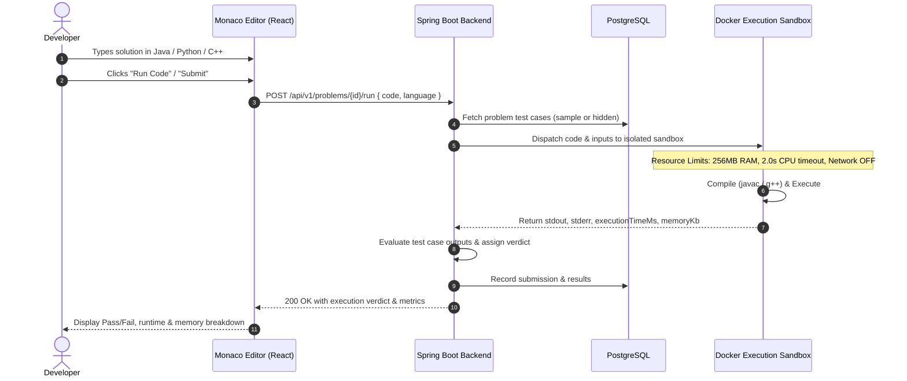

# CodeMaster AI - System Architecture

> Designed and engineered by **Ayananshu Mahapatra**.

## High-Level Architecture Flow

```mermaid
flowchart TD
    User["Developer / User (Browser)"]
    
    subgraph Frontend["React 18 + Vite + Tailwind CSS"]
        UI["Dashboard & Problem List"]
        Monaco["Monaco Code Editor Workspace"]
        AuthContext["Auth Context & JWT Store"]
    end

    subgraph Backend["Spring Boot 3 REST API Server (Port 8080)"]
        HealthController["Health & Telemetry Controller"]
        ProblemController["Problem Management Controller"]
        AuthModule["Auth & Security (Milestone 2)"]
        SubmissionModule["Submission Engine (Milestone 6)"]
        AIModule["Spring AI Service (Milestone 7)"]
        
        DataJPA["Spring Data JPA + HikariCP"]
        Flyway["Flyway Migrations"]
    end

    subgraph Storage["Persistence & Caching"]
        PostgreSQL[("PostgreSQL 16 Database\n(codemaster_db)")]
        Redis[("Redis 7 Cache &\nRate Limiter")]
    end

    subgraph Sandbox["Isolated Execution Sandbox (Milestone 5)"]
        ExecEngine["Execution Runner Service"]
        DockerHost["Hardened Docker Container\n(--network none, 2s timeout, 256MB)"]
    end

    User -->|HTTPS / UI Interactions| UI
    User -->|Code Writing & Submission| Monaco
    UI -->|REST API / Axios| Backend
    Monaco -->|POST /api/v1/problems/{id}/run| ProblemController
    
    Backend --> DataJPA
    Backend --> Flyway
    DataJPA --> PostgreSQL
    Flyway --> PostgreSQL
    Backend --> Redis
    
    SubmissionModule --> ExecEngine
    ExecEngine --> DockerHost
    AIModule -->|External LLM API| OpenAI["OpenAI / Gemini API"]
```

---

## Code Execution Security & Sandbox Pipeline



---

## Architectural Principles & Security Rules
1. **Never Execute Untrusted Code on the Host**: User code is executed only inside hardened, unprivileged containers with dropped capabilities (`cap-drop=ALL`), no network access, and strict cgroup memory/CPU limits.
2. **Layered Database Access**: Password hashes are stored using BCrypt; plain passwords are never persisted. Hidden test cases are filtered out before sending payloads to standard user endpoints.
3. **Graceful Fallbacks & High Availability**: HikariCP connection pool is configured with `initialization-fail-timeout=0` to ensure that intermittent database reconnects do not crash the REST application.
4. **Feature-Based Modular Monolith**: Code is packaged by business capability (`problem`, `user`, `submission`, `health`) making future microservice decomposition trivial.
