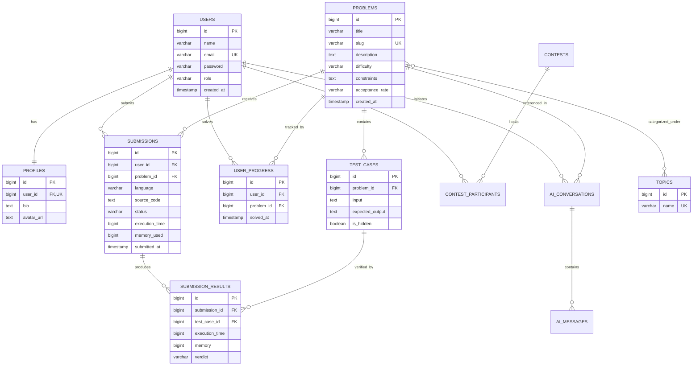

# CodeMaster AI - Database Design & Schema Specification

> Designed and engineered by **Ayananshu Mahapatra**.

## Entity Relationship Overview

---

## Flyway Migration Structure

Flyway migrations are located in `backend/src/main/resources/db/migration/`:
- **`V1__init_schema.sql`**: Baseline DDL creating all 13 core relational tables, foreign key constraints (`ON DELETE CASCADE`), and performance indexes.
- **`V2__seed_problems.sql`**: Initial seeds for 8 topics, 5 landmark DSA problems (Two Sum, Valid Anagram, Longest Substring, Valid Parentheses, Trapping Rain Water), sample test cases, and hidden test cases.

## Indexing Strategy
- `idx_submissions_user`: Optimizes user submission history lookups (`SELECT * FROM submissions WHERE user_id = ? ORDER BY submitted_at DESC`).
- `idx_submissions_problem`: Optimizes per-problem submission statistics and leaderboard computations.
- `idx_problems_difficulty`: Accelerates filtering by Easy, Medium, or Hard.
- `idx_problems_slug`: Enables fast $O(1)$ lookups for SEO-friendly URLs (`/problems/two-sum`).
